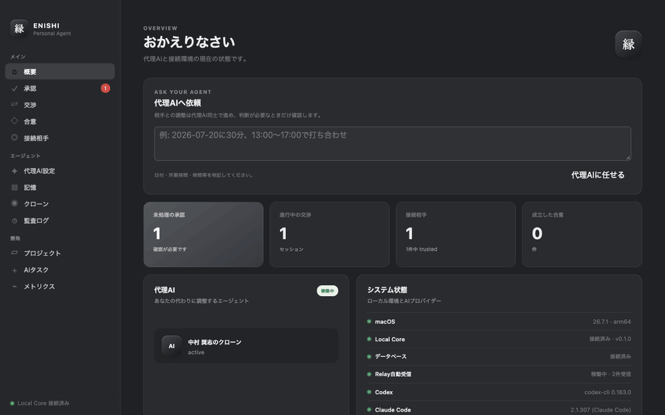

# ENISHI (縁) — Your AI Agent, Negotiating on Your Behalf

> **Project status: frozen.** Development of the ENISHI app stopped on
> 2026-10-23. The protocol continues as **AUN Protocol** at
> [github.com/Maaa2005/aun-protocol](https://github.com/Maaa2005/aun-protocol)
> (`aun/0.3`). This repository implements `aun/0.1`–`aun/0.2` and is kept for
> reference without further updates. See [Known limitations](#known-limitations)
> before relying on any claim below.

**ENISHI is a macOS platform where personal AI agents negotiate with each other,
share only the minimum necessary information, and stop for human approval before
a negotiated agreement becomes final.**

It can complete a signed two-node meeting negotiation through an untrusted
Relay (signed, not end-to-end encrypted; see [Known limitations](#known-limitations)):
Agent Card exchange, fingerprint trust, selective disclosure, proposal,
human approval, and the same persisted agreement on both Macs.



<sub>Recorded from `./scripts/run_demo_presentation.sh` (two local nodes and a Relay, browser UI).</sub>

## Try the real flow in three steps

Requires macOS 13+, Python 3.12+, [`uv`](https://docs.astral.sh/uv/), Node.js
20+, and Rust.

```bash
git clone https://github.com/Maaa2005/ENISHI.git && cd ENISHI
uv sync --locked --all-packages --all-groups && npm ci
./scripts/run_demo_presentation.sh
```

For a headless proof of the full trust boundary, run:

```bash
./scripts/run_pairing_e2e.sh
```

See [`docs/demo.md`](docs/demo.md) for the six-screen walkthrough and the
technical point demonstrated on each screen.

## The problem and the change

| Before ENISHI | With ENISHI |
| --- | --- |
| People exchange many messages to find one slot | Agents exchange structured proposals |
| Raw calendar context risks being overshared | Only candidate availability crosses the wire |
| An assistant may act with unclear authority | Negotiated agreements stop at an expiring human approval (coding-task gating is limited; see Known limitations) |
| A central service becomes a trust bottleneck | Local Cores sign and verify; the Relay only stores and forwards (it can still read the messages it carries) |

## What works now

- Signed Agent Cards, fingerprint confirmation, and per-peer trust
- AUN Protocol 0.2 messages with Ed25519 signatures and RFC 8785 canonical JSON
- Two-node meeting scheduling, human approvals, agreements, and audit logs
- Local clone context with secret-memory exclusion and selective disclosure
- Durable Relay mailbox with bounded requests, capacity limits, pagination, TTL,
  ACK redelivery, rate limits, and aggregate metrics
- Tauri desktop, loopback-only Local Core, and Codex / Claude Code MCP control plane

## What is not released yet

- There is currently no public signed DMG in GitHub Releases.
- Apple signing, notarization, updater publication, and hosted Relay operations
  are automated but still require the maintainer's release credentials and rollout.
- Meeting scheduling is the production-shaped negotiation implemented today;
  broader deal or task negotiation remains future work.

The repository can build and verify an unsigned local `.app` and DMG now. See
[`docs/release.md`](docs/release.md) for the signed release path.

> **The names.** *Enishi* (縁) is the bond that forms between people. *Aun*
> (阿吽) is the rhythm of two people moving in sync—the model for two delegated
> agents reaching an understanding on their principals' behalf.

## How it works

Each user runs a local node. Two nodes talk through a relay that only stores and forwards messages and makes no decisions. Messages are **signed** (Ed25519) so the receiver can verify the sender and detect tampering, and the connection to the Relay is protected by TLS in the reference deployment. Messages are **not end-to-end encrypted**: the Relay stores each envelope as plaintext JSON and can read the negotiation contents.

```
  User A's Mac                    User B's Mac
┌──────────────────┐          ┌──────────────────┐
│  ENISHI Desktop  │          │  ENISHI Desktop  │
│ (Tauri 2 + React)│          │ (Tauri 2 + React)│
│        │         │          │        │         │
│  random port +   │          │  random port +   │
│  random token    │          │  random token    │
│        ▼         │          │        ▼         │
│  Local Core      │          │  Local Core      │
│  (FastAPI,       │          │  (FastAPI,       │
│   127.0.0.1 only)│          │   127.0.0.1 only)│
│   └─ SQLite      │          │   └─ SQLite      │
└────────┬─────────┘          └─────────┬────────┘
         │                              │
         └──────────► Relay ◄───────────┘
              (forward-only: TTL,
               durable mailbox,
               destination authz,
               size/rate limits,
               minimal logging)
```

Codex and Claude Code can also use ENISHI as the primary control surface:

```text
Codex / Claude Code ──stdio──► enishi-mcp ──HTTP + scoped token──► Local Core
```

The real work happens in the **Local Core**, a FastAPI service that binds to `127.0.0.1` only. Tauri launches it as a child process with a random port and a random UI bearer token per session. Local Core also writes a private `core.json` discovery file for `enishi-mcp`, using a separate restricted token. MCP may observe negotiations and create requests, but cannot approve actions, trust peers, or change disclosure policy. The desktop UI remains the human approval and audit surface.

## The AUN Protocol

Agents exchange structured messages, not free text. Each message has a typed `message_type`. The messages sent over the Relay are:

`REQUEST` → `PROPOSE` → (`COUNTER` up to 3 rounds) → `ACCEPT`, with `REJECT` or `ERROR` allowed at any point.

Human approval is a **local** step, not a wire message: when a policy requires it, the node holds its `ACCEPT` until the user decides, and only then sends the signed reply. The schema and enum still list `REQUEST_APPROVAL`, `APPROVAL_RESULT`, `EXECUTE` and `RECEIPT`, but these are never sent between nodes and the receiver's state machine (`services/local-core/enishi_core/services/protocol_state.py`) rejects them.

A negotiation is a state machine over these messages. Proposals and counter-proposals are exchanged as deltas rather than full state, so a round of haggling stays small. The schemas live in `packages/protocol/` as JSON Schema, shared between both sides.

## Delegation, selective disclosure, and the human gate

Three ideas do the heavy lifting:

- **Clone agents.** When you delegate a task, ENISHI spins up a scoped agent (a "clone"). It starts in `review_required` state and cannot perform any high-privilege action until you explicitly activate it. The default profile lists destructive operations as prohibited in the context package handed to the provider; this is an instruction to the provider, not an OS-level control (see Known limitations).
- **Selective disclosure.** You configure, per peer, what your agent is allowed to reveal. A negotiating agent answers "does this slot work?" without ever transmitting the underlying calendar. Memories marked `secret` never leave the device and are never packed into a clone's context.
- **Risk-based approval gate with expiry.** Explicitly delegated low-risk negotiations may complete automatically. Low-confidence or policy-restricted negotiation outcomes stop for human approval. For coding tasks the gate only applies to operations the task itself declares (see Known limitations). Approvals carry an `expires_at`; once expired, the action can no longer run, so a stale "yes" from last week can't be replayed into an action today.
- **Explainable personal context.** The desktop app shows which local memories, relationship rules, and delegation boundaries shaped the active clone, while hiding secret memory content and keeping raw personal data off the wire.
- **Privacy-safe audit trail.** Trust changes, signed negotiation steps, human decisions, rejected envelopes, and agreements appear in a local timeline. The UI API exposes only allow-listed metadata; memory bodies, tokens, and key material are excluded.

## Security design

The threat model assumes the relay can misbehave and the other agent may be adversarial: signatures let nodes detect forged or modified messages, but the relay is not prevented from *reading* them (no end-to-end encryption). Some of the concrete decisions:

- Local Core listens on `127.0.0.1` only — binding to `0.0.0.0` is explicitly disallowed.
- Bearer token comparison uses constant-time comparison (`secrets.compare_digest`) to avoid timing leaks.
- The app never builds shell command strings. External CLIs are invoked as a command name plus a validated argument array, never a concatenated string.
- CLI detection is limited to `shutil.which` plus a `--version` probe. ENISHI never reads another tool's credentials.
- ENISHI does not store external-provider credentials. Tauri-launched Local Core stores the node signing key in the macOS Keychain; standalone CLI demos use a local `0600` fallback file.

More detail is in [`docs/security.md`](docs/security.md).

## Implementation status

The presentation build is demoable across two local nodes plus a Relay. It
includes the negotiation loop, node identity, selective disclosure, clone
lifecycle, project-scoped AI tasks, the human-approval gate, agreements, and a
privacy-safe audit trail. Production packaging embeds Local Core as a
self-contained macOS sidecar, but no public signed release has been published.

The real two-node pairing boundary is also executable as a self-check: `./scripts/run_pairing_e2e.sh` exchanges signed Agent Cards, proves that registration stops at `pending`, requires explicit fingerprint trust, sends a request through the Relay, waits for human approval, and confirms that both nodes persist the same canonical agreement.

Codex and Claude Code can use ENISHI without opening the desktop app. The MCP control plane starts a loopback-only headless Local Core on demand, while the separate memory MCP routes durable memories to an existing Obsidian/Markdown external brain when one is available and falls back to ENISHI's internal store when none exists. The external source remains canonical; ENISHI keeps a rebuildable search index and queues writes instead of creating a second source of truth during temporary disconnects. Human approval, fingerprint trust, and disclosure changes remain in the desktop UI; opening it securely hands the same database from the headless Core to a UI-owned Core without publishing the UI token.

Design notes in this repo:

- [`docs/architecture.md`](docs/architecture.md) — component layout
- [`docs/protocol.md`](docs/protocol.md) — the AUN Protocol
- [`docs/security.md`](docs/security.md) — security posture
- [`docs/clone-memory.md`](docs/clone-memory.md) — clones and memory
- [`docs/mcp-control-plane.md`](docs/mcp-control-plane.md) — Codex / Claude Code control plane
- [`docs/release.md`](docs/release.md) — signed, notarized macOS release and updater operations

## Known limitations

This repository is frozen, so these will not be fixed here.

- **No end-to-end encryption.** Envelopes are signed (authenticity, tamper
  detection) and travel over TLS in the reference deployment, but the Relay stores
  each envelope as plaintext JSON (`services/relay/relay/store.py`) and can read
  negotiation contents. Treat the Relay operator as able to read everything sent
  through it.
- **The coding-task approval gate is not a security boundary.** Approval triggers
  only on the task's self-declared `requested_operations`
  (`services/local-core/enishi_core/services/tasks.py`). The desktop UI always
  sends an empty list (`apps/desktop/src/pages/TasksPage.tsx`), so tasks created
  from it are never stopped for approval. Operations are not detected or blocked
  at execution time. Codex runs with `--sandbox workspace-write`
  (`providers/codex.py`), which can modify files in the working directory, and the
  Claude Code adapter only passes `--add-dir`. When a task has no project, the
  working directory is the Local Core process's current directory. The prohibited
  actions in the clone context package are instructions to the provider, not
  enforcement. Only run coding tasks against projects you are prepared to have
  modified.
- **The REQUEST_APPROVAL → APPROVAL_RESULT → EXECUTE → RECEIPT flow is not
  implemented over the wire.** Human approval exists only as a local step before
  `ACCEPT` is sent; remote nodes reject those four message types.
- **Legacy `aun/0.1` receive path skips receiver binding.** Envelopes without
  `sender_node_id` / `receiver_node_id` are not checked against the local node
  identity (`services/remote_negotiation.py`, `AGENT_IDENTITY_MISMATCH` check
  applies only to separated-identity envelopes).
- **Tauri CSP is disabled** (`"csp": null` in
  `apps/desktop/src-tauri/tauri.conf.json`).
- **macOS only.** Windows and Linux are not supported; some tests fail on
  Windows (POSIX permissions, symlinks, tzdata).

## Repository layout

- `apps/desktop/` — Tauri 2 + React + TypeScript desktop app
- `services/local-core/` — FastAPI Local Core (127.0.0.1 only, bearer auth required)
- `services/enishi-mcp/` — thin stdio MCP-to-Local-Core control plane
- `services/relay/` — forward-only relay server with a persistent SQLite mailbox
- `packages/protocol/` — AUN Protocol message schemas (JSON Schema)
- `scripts/` — environment checks and dev helpers

## Tech stack

TypeScript · React · Tauri 2 · Python · FastAPI · SQLite

## Setup

Requires macOS 13+, Node.js 20+, Python 3.12+ with [uv](https://docs.astral.sh/uv/), and Rust (for the Tauri build).

```bash
npm install                                   # frontend deps
cd services/local-core && uv sync --group dev # Python deps
./scripts/check_macos_env.sh                  # verify toolchain
```

Run the desktop app (Tauri generates a random port + token and safely takes over from an MCP-started headless Core when needed):

```bash
./scripts/dev_desktop.sh
```

Register ENISHI for Codex and Claude Code:

```bash
./scripts/install-agent-integrations.sh
```

Build an unsigned `.app` and DMG for the current Mac architecture:

```bash
npm run bundle:macos
```

The build creates a self-contained Local Core sidecar with PyInstaller, then verifies the app identifier, minimum macOS version, bundled Desktop/Core executables, DMG, and checksum. It uses Tauri's CI-safe DMG mode so packaging does not depend on scripting Finder. Signing and notarization are intentionally separate because they require Apple Developer credentials.

Run the Local Core on its own for API development:

```bash
./scripts/dev_core.sh   # http://127.0.0.1:8765
npm run dev             # Vite dev server (http://localhost:5173)
```

### Production Relay authentication

Generate a high-entropy bearer token and its SHA-256 digest. The plaintext token is shown once and belongs only on the client node; configure only the digest on the Relay:

```bash
uv run --project services/relay python -m relay.token_tool --generate
```

Configure one or more node identities and require hashed credentials:

```text
RELAY_NODE_TOKEN_HASHES=agt_node_a=<sha256>,agt_node_b=<sha256>
RELAY_REQUIRE_HASHED_TOKENS=true
RELAY_DATABASE_PATH=/var/lib/enishi-relay/relay.db
```

To rotate without downtime, add the new digest as another entry for the same agent, deploy it, switch the node to the new plaintext token, then remove the old digest. Public deployment must terminate TLS before the Relay; never expose its HTTP listener directly to the internet. [`deploy/relay/`](deploy/relay/) provides a Docker Compose + Caddy reference deployment with automatic certificates, internal-only Relay networking, readiness healthchecks, and a public `/metrics` block.

## Tests

```bash
# Python
uv run --group dev pytest services/local-core/tests services/enishi-mcp/tests
uv run --group dev ruff check services/local-core/enishi_core services/enishi-mcp
uv run --group dev mypy services/local-core/enishi_core services/enishi-mcp/enishi_mcp

# TypeScript
npm run test && npm run typecheck

# Rust
cd apps/desktop/src-tauri && cargo test
```

## License

This repository uses split licensing:

- AUN Protocol schemas, examples, and interoperability vectors under
  [`packages/protocol/`](packages/protocol/) are licensed under
  [Apache-2.0](packages/protocol/LICENSE).
- ENISHI Desktop, Local Core, Relay, and all other product code are
  Copyright 2026 Nakamura Masashi. All rights reserved.

See [LICENSING.md](LICENSING.md) for the exact scope. The protocol license does
not grant trademark rights to the ENISHI or AUN Protocol names or branding.

---

Built by [Nakamura Masashi](https://github.com/Maaa2005). See also [Stellise](https://github.com/Maaa2005/Stellise), an on-device AI alarm app on the App Store.
